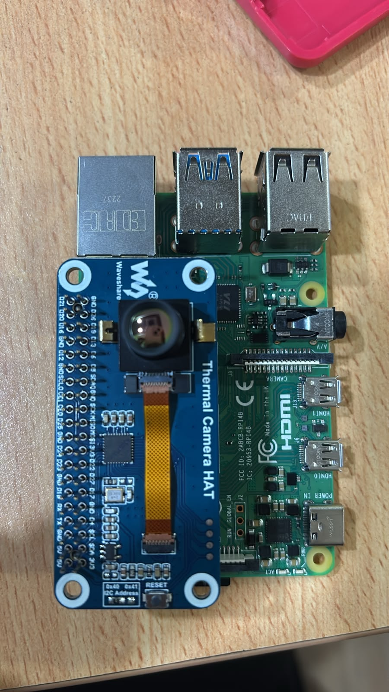
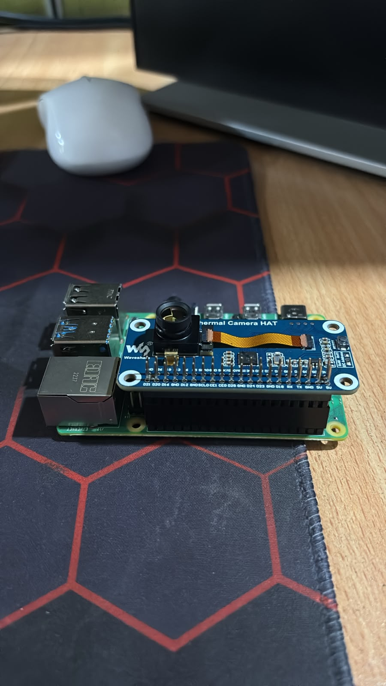
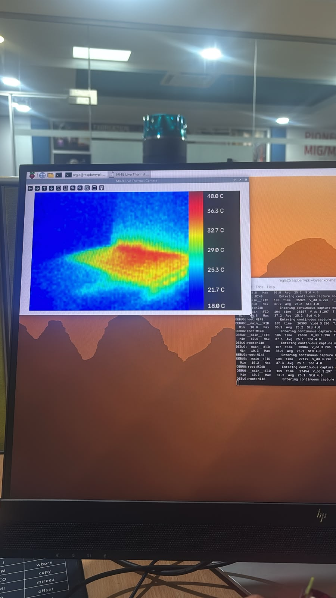
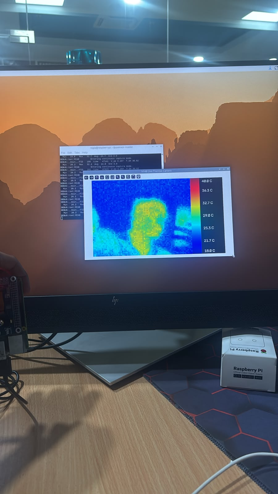

#  Raspberry Pi 4 – Real-Time Thermal Camera

A real-time thermal imaging and temperature monitoring system built using **Raspberry Pi 4** and the **Meridian Innovation MI48 Thermal Camera**.

The project captures thermal data, processes temperature frames, enhances image visualization using OpenCV, and displays a live thermal image with a Celsius temperature colour scale.

---

##  Project Overview

This project aims to develop a real-time thermal camera system capable of detecting temperature variations and visualizing heat distribution.

The Raspberry Pi 4 communicates with the MI48 thermal camera through SPI and I2C interfaces. Captured thermal frames are processed using Python, NumPy, and OpenCV to generate an enhanced thermal visualization.

##  Features

- Real-time thermal image capturing.
- Live temperature monitoring in Celsius (°C).
- Thermal colour mapping using OpenCV.
- Temperature statistics:
  - Minimum temperature
  - Maximum temperature
  - Average temperature
  - Centre temperature
- Image enlargement using interpolation.
- Temperature colour scale with numerical labels.
- Continuous thermal frame acquisition.
- Optional thermal data recording.
- Modular Python project architecture.

## 🛠️ Hardware Requirements

| Component | Description |
|---|---|
| Main Controller | Raspberry Pi 4 |
| Thermal Camera | Meridian Innovation MI48 |
| Camera Interface | MI48 Thermal Camera HAT |
| Communication | SPI and I2C |
| Operating System | Raspberry Pi OS |
| Power Supply | Raspberry Pi compatible power supply |
| Display | HDMI Monitor |

##  Software Requirements

- Python 3
- OpenCV
- NumPy
- GPIO Zero
- SMBus
- SPIDev
- SenXor MI48 Python library

## Technologies Used

| Technology | Purpose |
|---|---|
| Python | Main programming language |
| OpenCV | Thermal image processing and visualization |
| NumPy | Temperature frame processing |
| SPI | Thermal camera data communication |
| I2C | Camera configuration and communication |
| Raspberry Pi OS | Hardware operating environment |

##  Project Structure

```text
thermal_project/
│
├── main.py
│   └── Main application and camera control
│
├── config.py
│   └── Camera and display configuration
│
├── temperature.py
│   └── Temperature statistics calculation
│
├── thermal_processing.py
│   └── Thermal image processing and enhancement
│
├── README.md
│   └── Project documentation
## 📸 Project Gallery

### 1. Thermal Camera Hardware Setup





### 2. Live Thermal Imaging Output

**Thermal detection – Object**



**Thermal detection – Human**


